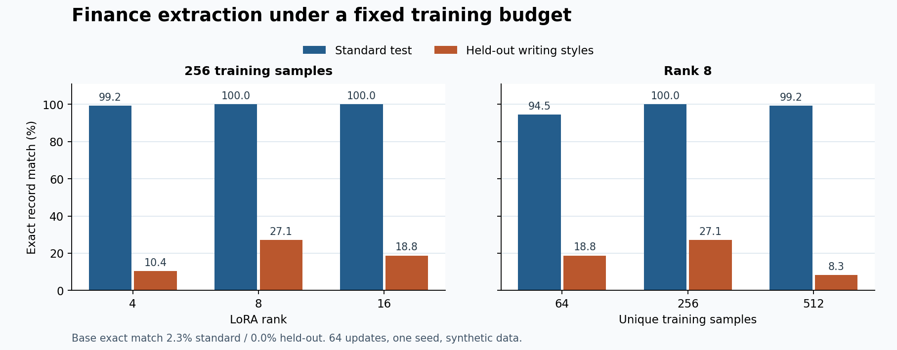

# Finance-LoRA-Extractor · 金融文本结构化提取

[](https://github.com/a978623/Finance-LoRA-Extractor/actions/workflows/ci.yml)

用 Qwen2.5-0.5B-Instruct 从中文年报风格文本抽取六个字段。项目包含完整的合成数据集、基础模型推理、只监督回答部分的 LoRA SFT、严格 JSON 评测和两组消融。基础模型采用 Apache-2.0 许可。[Qwen 模型卡](https://huggingface.co/Qwen/Qwen2.5-0.5B-Instruct)

## 任务定义

输入一段财务披露原文，模型输出一个 JSON 对象。

| 字段 | 含义 | 缺失值 |
| --- | --- | --- |
| `company_name` | 企业名称 | `null` |
| `revenue` | 本期营业收入，保留金额单位 | `null` |
| `net_profit` | 本期净利润，保留符号和金额单位 | `null` |
| `risks` | 主要风险原文片段列表 | `[]` |
| `operating_changes` | 经营变化原文片段列表 | `[]` |
| `key_metrics` | 其他指标的 `name`、`value` 对象列表 | `[]` |

文本涉及上年、同行或已更正的数字时，抽取报告主体本期的最终披露值。所有示例均为合成文本。项目测量信息抽取能力，输入材料的来源和数字真实性由使用者掌握。

## 数据与实验

数据共 1,264 条。训练 1,024 条，验证 64 条，常规测试 128 条，压力测试 48 条。各分割的企业 ID 和原文互不重合。常规测试共享四种模板，压力测试另有六种写法，覆盖对话、披露修订、同行对照、只披露上期数据、匿名和文字形式的亏损。[数据清单](data/synthetic-v1/manifest.json)

| 对照 | 固定条件 | 改动 |
| --- | --- | --- |
| 微调前后 | 同一基座版本、提示词、贪心解码和测试集 | 基础模型 / LoRA |
| Rank | 256 条训练样本，64 次更新 | `r = 4 / 8 / 16` |
| 数据量 | `r = 8`，64 次更新 | `N = 64 / 256 / 512` 个唯一样本 |

64 次更新，每次 8 条样本，共 512 次样本呈现。小数据组重复更多轮，因此数据量对照衡量固定更新次数和样本呈现次数下的联合影响。各组 `alpha/r = 2`，固定随机种子、学习率、适配层、训练步数和推理参数。总 token 数随样本长度略有差异。

在匹配提示词的比较中，Rank 8、256 条样本组将常规集整条准确率从 **2.3% 提升到 100%**，压力集从 **0% 提升到 27.1%**。常规集仍共享训练模板，压力测试换了写法、措辞和披露场景。完整数值、失败案例和原始预测见 [实验报告](results/README.md)。



## 在本地运行

使用 Python 3.11 或更新版本。先按显卡和驱动选择 PyTorch 构建版本，已有可用 CUDA 环境时可以直接使用。随后安装训练依赖。 [PyTorch 官方安装说明](https://pytorch.org/get-started/locally/)

```powershell
python -m pip install -r requirements.txt
python -c "import torch; print(torch.__version__, torch.cuda.is_available())"
```

基础模型权重约 1 GB，首次运行会下载。命令固定模型提交，以便使用同一组权重。[固定权重版本](https://huggingface.co/Qwen/Qwen2.5-0.5B-Instruct/tree/7ae557604adf67be50417f59c2c2f167def9a775)

```powershell
$rev = '7ae557604adf67be50417f59c2c2f167def9a775'
python -m finance_lora.predict --revision $rev --data examples/input.jsonl --out runs/example-base.jsonl --device cuda
python -m finance_lora.experiment --out runs/benchmark-v1 --device cuda --no-gradient-checkpointing
```

如果显存不足，可启用默认的梯度检查点，即省略 `--no-gradient-checkpointing`。没有 CUDA 时可用 `--device cpu` 做小样本推理。整套训练会明显更慢。

将 `--adapter runs/benchmark-v1/adapters/r8-n256` 加到推理命令中即可加载该组 LoRA。预测文件必须使用新路径。自定义输入文件为 UTF-8 JSONL，每行提供唯一的 `id` 和非空的 `text`。实验输出默认保存在 `runs/`，包含 adapter、原始模型输出、分字段指标和错误记录。中断后可在条件之间加 `--resume`，要求数据、代码、配置和依赖版本保持一致。

用真实适配器处理的独立示例可直接查看。[输入原文](examples/input.jsonl) · [模型输出](examples/output-r8-n256.jsonl)

## 评测和复现

```powershell
python -m finance_lora.dataset --out data/generated --seed 2026
python -m finance_lora.evaluate --gold data/synthetic-v1/test.jsonl --predictions results/predictions/r8-n256-test.jsonl --out runs/test-metrics.json --errors runs/test-errors.jsonl
python -m unittest discover -s tests -v
```

第二条命令直接读取仓库保存的原始模型预测，可以在没有 GPU 时复核。原始生成文本不做 JSON 修复。格式错误不获得字段分。整条精确匹配要求六字段全部一致，列表 F1 按条目集合计分，金额准确率另外用 Decimal 统一元、万元和亿元后比较。

| 模块 | 用途 |
| --- | --- |
| `finance_lora/dataset.py` | 可重复的数据生成、隔离分割和校验和 |
| `finance_lora/modeling.py` | 同一套提示词、对话模板和回答区屏蔽 |
| `finance_lora/train.py` | LoRA 训练、学习率调度、参数量与显存记录 |
| `finance_lora/predict.py` | 基础模型与适配器的匹配推理 |
| `finance_lora/evaluate.py` | JSON 验证、指标计算和逐条错误记录 |
| `finance_lora/experiment.py` | 调度六组对照，分离评测输入和金标准 |

## 面试里怎样解释

- **LoRA 学到什么。** 冻结基座权重，通过低秩增量调整选定线性层。监督信号来自回答 JSON 与结束标记，训练可改变字段选择、原文摘取和输出结构。应结合格式合法率与内容指标判断提升来自哪里。[LoRA 原论文](https://arxiv.org/abs/2106.09685) · [PEFT LoRA 文档](https://huggingface.co/docs/peft/en/package_reference/lora)
- **何时用 LoRA，何时用 RAG。** 当输入已经包含足够原文，任务是将反复出现的文本映射成稳定的六字段输出，LoRA 可以学习这套行为。若问题先要在海量披露中找最新文件及段落，则先用 RAG 找证据，再让抽取模型处理检索到的段落。
- **如何评价。** 分开测格式、字段、数值与完整记录，并加入看不见的写法和缺失字段。报告常规集和压力集，结合原始失败案例解释误差。单一训练种子和合成数据的实验只能回答本设置内的比较。

代码与合成数据采用 [MIT 许可证](LICENSE)。基座权重与 LoRA 适配器默认保存在本地缓存和运行目录。
