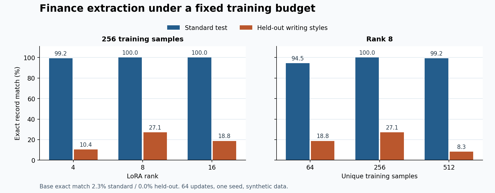

# LoRA 金融抽取实验报告

## Material Passport

- Origin Skill: experiment-agent
- Origin Mode: run
- Origin Date: 2026-11-10
- Verification Status: ANALYZED
- Version Label: exp_result_v1

## 实测对照

在 RTX 5060 Laptop GPU 上，已完成基础模型推理和五次 LoRA 训练。常规集使用 128 条未见过的企业文本，仍共享训练模板。压力集使用 48 条不同模板文本。两套测试均使用相同提示词和贪心解码。

| 条件 | Rank | 唯一样本 | 常规结构合法率 | 常规整条准确率 | 压力整条准确率 | 压力金额准确率 | 压力列表 F1 | 训练秒数 |
| --- | ---: | ---: | ---: | ---: | ---: | ---: | ---: | ---: |
| base | — | — | 15.6% | 2.3% | 0.0% | 0.0% | 0.0% | — |
| r4-n256 | 4 | 256 | 99.2% | 99.2% | 10.4% | 65.8% | 55.9% | 60.0 |
| r8-n256 | 8 | 256 | 100.0% | 100.0% | 27.1% | 69.7% | 59.1% | 57.3 |
| r16-n256 | 16 | 256 | 100.0% | 100.0% | 18.8% | 56.6% | 48.8% | 58.9 |
| r8-n64 | 8 | 64 | 99.2% | 94.5% | 18.8% | 68.4% | 53.9% | 59.8 |
| r8-n512 | 8 | 512 | 99.2% | 99.2% | 8.3% | 61.8% | 49.8% | 59.5 |



表中整条准确率要求六个字段都精确匹配。金额准确率比较金额单位换算后的数值，分母为金标准中有金额的字段。列表 F1 对风险、经营变化和指标三组条目汇总 TP、FP 和 FN。格式不合法的输出在主评测中不获得字段分。

## 结果分析

- **微调前后。** Rank 8、256 条样本这一预设对照，常规整条准确率从 2.3% 变为 100.0%，压力整条准确率为 27.1%。基础模型在常规集的 JSON 语法合法率已经达到 99.2%，但有 107 条未通过字段结构校验。常见失败是字段集合不符、金额单位缺失，以及把金额写成 JSON 数字。LoRA 提升了输出契约的一致性，常规集也同时提高了字段抽取表现。严格计分会把两类改进叠加，不能仅凭这一对照拆分各自贡献。
- **Rank。** 256 条训练样本时，r=4、8、16 的压力整条准确率依次为 10.4%、27.1%、18.8%。三组常规表现接近饱和，应结合压力测试和参数量判断这一次运行。更大的 Rank 增加可训练参数和表达容量，单个种子无法确定稳定的最优 Rank。
- **数据量。** Rank 8 下，N=64、256、512 的压力整条准确率依次为 18.8%、27.1%、8.3%。每组固定 512 次样本呈现，三个数据池对应约 8、2、1 轮。因此比较的是相同训练预算下的样本多样性和重复使用，并非独立估计数据量的因果效应。
- **压力边界。** r8-n256 正确提取 53/76 个已披露金额。在结构合法的预测里，28/53 个本该为空的字段被填入。这个比率只衡量无依据填充空字段，不能覆盖写错金额或从旧稿抄数等错误。

## 可复查的失败案例

下列案例均来自 r8-n256 的原始预测，可用样本 ID 对照数据与输出。

| 样本 ID | 金标准 | 实际错误 |
| --- | --- | --- |
| stress-0002 | 更正后的营收 9165.9 万元、净利润 127.1 万元 | 取了更正前的 6076.3 万元和 595.7 万元 |
| stress-0004 | 只给上期金额，本期两项应为 null | 把上期 2899.1 万元和 708.4 万元填成本期 |
| stress-0005 | 匿名材料，公司名应为 null | 把「匿名备忘第1条」当成企业名称，并添加原文未披露的指标 |
| stress-0018 | 经营变化是「将质检安排前移至每批发货之前」 | 省略开头的「将」。语义接近，但未通过要求逐字抽取的评测 |

[压力集原文及标签](../data/synthetic-v1/stress.jsonl) · [r8-n256 压力集原始生成](predictions/r8-n256-stress.jsonl)

## 复核方式与局限

- 硬件为 RTX 5060 Laptop GPU，BF16；五组训练循环合计 295.5 秒。最高 PyTorch 已分配显存约 3.81 GiB。训练耗时不含加载模型、分词、推理和下载。
- 环境为 Python 3.11.15、PyTorch 2.13.0+cu130、Transformers 4.57.6、PEFT 0.18.0、Accelerate 1.12.0。模型提交固定为 `7ae557604adf67be50417f59c2c2f167def9a775`。
- 正式运行使用单种子 42。训练集先按固定前缀选择样本，再按种子洗牌。验证集用于短流程检查，测试集未用于选检查点或修改训练设置。没有对真实年报、其他基础模型或多种子稳定性做验证。
- 初始运行在定稿提示词之前启动了基础模型推理。报告弃用了这一轮预测。五个适配器均以定稿提示词训练，经版本、训练前缀和配置检查后，用它们和基础模型重新生成了全部预测。正式推理输入文件仅含样本 ID 和原文。
- 同模板的常规集反映公司与数字替换后的任务执行能力；压力集同时更换文风、部分术语和信息布局。两者的差距不能归因于某一个因素。当前实验也没有做全量微调、不同提示词或 RAG 的实证对照。

```powershell
python -m finance_lora.experiment --out runs/benchmark-v1 --device cuda --no-gradient-checkpointing
python -m finance_lora.evaluate --gold data/synthetic-v1/stress.jsonl --predictions results/predictions/r8-n256-stress.jsonl --out runs/checked-metrics.json
```

[完整指标、哈希与训练元数据](experiment.json) · [每组原始模型输出](predictions/)
